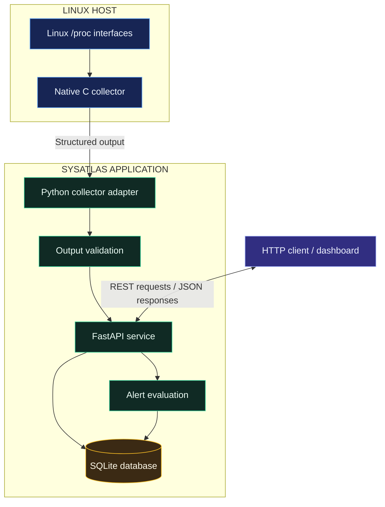

# ◈ SysAtlas
### Linux Systems Observability & Reliability Platform

**A systems-engineering portfolio project combining C, Python, FastAPI, SQLite, automated testing, containerization, and reliability-focused engineering practices.**

<p align="center">
  
  
  
  
  
  
</p>

<p align="center">
  <strong>Systems Programming · Observability · API Engineering · Reliability · Testing</strong>
</p>

---

## 01 — Overview

SysAtlas is a Linux systems observability and reliability platform designed to explore how low-level operating-system metrics can be collected, validated, persisted, exposed through APIs, and used to support operational monitoring.

The project combines a native C collector with a Python service layer, local database persistence, alerting logic, and automated quality checks.

Rather than treating monitoring as a single script, SysAtlas organizes the system into distinct components with explicit responsibilities and documented engineering trade-offs.

### The engineering problem

Systems produce operational signals, but collecting those signals is only the beginning. A useful monitoring pipeline also needs to handle invalid data, process failures, persistence, API access, alert history, testing, and deployment.

SysAtlas explores that end-to-end workflow in a compact, inspectable codebase.

| Engineering challenge | SysAtlas approach |
|---|---|
| Operating-system metric collection | Native C collector using Linux system interfaces |
| Process execution failures | Python subprocess boundary with error handling |
| Data validation | Structured application configuration and validation |
| Historical observations | SQLite persistence |
| Monitoring access | FastAPI REST endpoints |
| Threshold-based notifications | Alert evaluation and alert-event history |
| Regression prevention | Python tests and a CI workflow |
| Reproducible execution | Docker and Docker Compose configuration |
| Operational readiness | Runbooks, threat model, incident response, and design records |

## 02 — System architecture

The architecture separates collection, application logic, persistence, and external access.



> The diagram describes the intended component flow. Validate exact runtime wiring and deployment behavior against the implementation and test results before treating every path as production-verified.

### Component responsibilities

| Component | Technology | Responsibility |
|---|---|---|
| Systems collector | C | Read supported Linux system metrics and emit structured output |
| Collector adapter | Python | Launch the collector and manage its execution boundary |
| Configuration | Python | Centralize application settings |
| API service | FastAPI | Expose application operations over HTTP |
| Persistence layer | SQLite | Store observations and alert events |
| Alert logic | Python | Evaluate configured monitoring conditions |
| Test suite | Pytest and shell test | Exercise application and collector behavior |
| Delivery workflow | GitHub Actions | Automate configured checks |
| Container configuration | Docker | Define containerized execution |
| Engineering documentation | Markdown | Explain architecture, risks, reliability, and operational practices |

## 03 — Feature matrix

| Capability | Purpose | Implementation area |
|---|---|---|
| Linux metric collection | Access host-level system information | `collector/src/collector.c` |
| Collector integration | Invoke and handle collector execution | `app/collector.py` |
| Application configuration | Keep settings organized | `app/config.py` |
| REST API | Provide HTTP access to system data | `app/main.py` |
| Data persistence | Retain collected metrics | `app/db.py` |
| Alert evaluation | Apply monitoring rules | `app/alerts.py` |
| Application testing | Check service behavior | `tests/test_app.py` |
| Collector testing | Exercise collector checks | `collector/tests/test_collector.sh` |
| CI workflow | Automate configured validation | `.github/workflows/ci.yml` |
| Container execution | Define image and service configuration | `Dockerfile`, `docker-compose.yml` |
| Security documentation | Describe threats and controls | `docs/THREAT_MODEL.md`, `docs/SECURITY_ARCHITECTURE.md` |
| Reliability documentation | Document operational practices | `docs/SRE_PLAYBOOK.md`, `docs/ERROR_BUDGET.md` |

## 04 — Repository structure

```text
sysatlas/
├── .github/
│   └── workflows/
│       └── ci.yml
├── app/
│   ├── __init__.py
│   ├── alerts.py
│   ├── collector.py
│   ├── config.py
│   ├── db.py
│   └── main.py
├── collector/
│   ├── src/
│   │   └── collector.c
│   └── tests/
│       └── test_collector.sh
├── docs/
│   ├── engineering/
│   │   ├── ADR-001-local-sqlite.md
│   │   ├── ADR-002-c-collector.md
│   │   ├── ARCHITECTURE_EVOLUTION.md
│   │   ├── ENGINEERING_RFC_TEMPLATE.md
│   │   ├── OPERABILITY_REVIEW.md
│   │   ├── PERFORMANCE_REPORT.md
│   │   ├── RELIABILITY_REVIEW.md
│   │   ├── RISK_REGISTER.md
│   │   ├── SCALABILITY_ANALYSIS.md
│   │   ├── SECURITY_REVIEW.md
│   │   ├── SYSTEM_DESIGN.md
│   │   └── TECHNICAL_DEBT.md
│   ├── CAPACITY_PLANNING.md
│   ├── ENGINEERING_AUDIT.md
│   ├── ERROR_BUDGET.md
│   ├── INCIDENT_RESPONSE.md
│   ├── QUALITY_REPORT.md
│   ├── SECURITY_ARCHITECTURE.md
│   ├── SRE_PLAYBOOK.md
│   ├── TECHNICAL_DEBT.md
│   ├── TEST_MATRIX.md
│   └── THREAT_MODEL.md
├── portfolio/
│   ├── ARCHITECTURE_DEFENSE.md
│   ├── DEMO_SCRIPT.md
│   ├── GITHUB_ABOUT.md
│   ├── INTERVIEW_QA.md
│   ├── PROJECT_SUMMARY.md
│   ├── RESUME_BULLETS.md
│   └── TECHNICAL_WALKTHROUGH.md
├── tests/
│   └── test_app.py
├── .env.example
├── .gitignore
├── CHANGELOG.md
├── CONTRIBUTING.md
├── Dockerfile
├── docker-compose.yml
├── LICENSE
├── Makefile
├── README.md
└── requirements.txt
```

## 05 — API reference

The following endpoints are part of the project's documented API surface. Confirm request parameters, response schemas, and status codes in `app/main.py` before integrating external clients.

| Endpoint | Method | Intended purpose |
|---|---|---|
| `/health` | GET | Check application health |
| `/ready` | GET | Check application readiness |
| `/api/v1/collect` | POST | Trigger a collection operation |
| `/api/v1/metrics` | GET | Retrieve metric observations |
| `/api/v1/alerts` | GET | Retrieve alert information |

### Example API exploration

Once the service is running, open its interactive API documentation if FastAPI's documentation routes are enabled:

```text
http://127.0.0.1:8000/docs
```

Health check:

```powershell
Invoke-RestMethod http://127.0.0.1:8000/health
```

Metric retrieval:

```powershell
Invoke-RestMethod http://127.0.0.1:8000/api/v1/metrics
```

Alert retrieval:

```powershell
Invoke-RestMethod http://127.0.0.1:8000/api/v1/alerts
```

These examples assume the server is listening on port `8000` and that the endpoints are configured as shown.

## 06 — Data and persistence

SQLite provides a lightweight persistence layer suitable for a local observability prototype.

| Data category | Purpose |
|---|---|
| Metric observations | Preserve collected measurements for subsequent queries |
| Alert events | Retain alert-related records for inspection |
| Configuration | Control runtime behavior through application settings |

The database implementation lives in `app/db.py`. Review that module for the actual schema, initialization strategy, transaction boundaries, and query behavior.

### Persistence design considerations

- Define clear ownership of database operations.
- Handle database errors without silently losing important information.
- Keep schema evolution explicit.
- Consider retention policies as the number of observations grows.
- Evaluate concurrency and write throughput before scaling beyond a local deployment.

## 07 — Reliability and failure handling

SysAtlas is designed to make important failure boundaries visible and testable.

| Failure scenario | Engineering consideration |
|---|---|
| Collector exits unsuccessfully | Capture and report process failures |
| Collector execution hangs | Use a bounded execution timeout |
| Output is malformed | Reject invalid data before it enters application workflows |
| Database operation fails | Surface errors and preserve consistency |
| Metric crosses a threshold | Evaluate the relevant alert rule |
| API request fails | Return an appropriate HTTP response |
| Regression is introduced | Run automated tests in development and CI |

The exact handling and recovery guarantees depend on the implementation. The documentation under `docs/` provides the project's reliability, security, and operational design material.

## 08 — Local development

### Prerequisites

- Git
- Python compatible with the project's dependencies
- A C compiler and Linux-compatible build environment for the native collector
- Docker and Docker Compose if using the containerized setup

**Platform note:** The collector relies on Linux-specific interfaces. Running the Python service directly in Windows PowerShell does not automatically provide the Linux `/proc` filesystem. Use Linux, WSL2, or a compatible Linux container for collector execution.

### Clone the repository

```bash
git clone https://github.com/akankshad1712/sysatlas.git
cd sysatlas
```

### Create a Python environment

Windows PowerShell:

```powershell
python -m venv .venv
.\.venv\Scripts\Activate.ps1
python -m pip install --upgrade pip
pip install -r requirements.txt
```

Linux or macOS:

```bash
python3 -m venv .venv
source .venv/bin/activate
python -m pip install --upgrade pip
pip install -r requirements.txt
```

### Run the tests

```bash
python -m pytest -q
```

### Run with Docker Compose

```bash
docker compose up --build
```

Stop the containers:

```bash
docker compose down
```

> Confirm the Docker Compose service configuration, collector build requirements, and application startup command in the repository before relying on these commands. Do not report a successful build or passing tests until you have run them.

## 09 — Testing strategy

SysAtlas includes application tests and a separate collector test script.

| Test layer | Location | Goal |
|---|---|---|
| Application tests | `tests/test_app.py` | Validate application behavior |
| Collector checks | `collector/tests/test_collector.sh` | Exercise native collector behavior |
| CI validation | `.github/workflows/ci.yml` | Automate configured checks |

Suggested local validation sequence:

```bash
python -m pytest -q
```

Then run the collector test script in a compatible Linux environment:

```bash
sh collector/tests/test_collector.sh
```

Inspect the workflow file to identify exactly which commands run in CI. A green CI result is evidence for those checks, not proof of every possible runtime condition.

## 10 — Containerization and CI/CD

The repository includes the following delivery configuration:

| File | Role |
|---|---|
| `Dockerfile` | Describes container image construction |
| `docker-compose.yml` | Defines the local multi-service or application setup |
| `.github/workflows/ci.yml` | Defines automated CI checks |
| `requirements.txt` | Lists Python dependencies |
| `Makefile` | Provides project command targets |

Before releasing a change, review dependency updates, run the tests, inspect container build output, and verify that the workflow passes on GitHub Actions.

## 11 — Security considerations

Security should be part of the design and review process, not an afterthought.

- Keep credentials and machine-specific secrets out of source control.
- Use `.env.example` for placeholder configuration only.
- Validate data received from external process boundaries.
- Avoid invoking commands through a shell when direct subprocess execution is sufficient.
- Bound process execution and output consumption.
- Restrict API exposure to the intended environment.
- Review dependency versions and container configuration.
- Define appropriate access controls before exposing the service to an untrusted network.

Related documents:

- `SECURITY.md`
- `docs/THREAT_MODEL.md`
- `docs/SECURITY_ARCHITECTURE.md`
- `docs/engineering/SECURITY_REVIEW.md`

## 12 — Engineering decision records

The `docs/engineering/` directory captures architectural reasoning and engineering trade-offs.

| Decision record | Subject |
|---|---|
| `ADR-001-local-sqlite.md` | Local persistence with SQLite |
| `ADR-002-c-collector.md` | Native C collector |
| `SYSTEM_DESIGN.md` | Overall system design |
| `ARCHITECTURE_EVOLUTION.md` | Potential architectural evolution |
| `SCALABILITY_ANALYSIS.md` | Scaling considerations |
| `PERFORMANCE_REPORT.md` | Performance analysis |
| `TECHNICAL_DEBT.md` | Known or potential technical debt |
| `RISK_REGISTER.md` | Engineering risk tracking |

These documents should distinguish measured results from estimates, intended future improvements, and unverified assumptions.

## 13 — Roadmap

Potential directions for further development:

- [ ] Add reproducible Linux development and build instructions.
- [ ] Document concrete metric schemas and API response examples.
- [ ] Add dashboard screenshots or a short recorded demonstration.
- [ ] Establish explicit metric retention and database maintenance policies.
- [ ] Add load and performance benchmarks with reproducible methodology.
- [ ] Improve structured logging and diagnostic context.
- [ ] Add integration tests for collector, API, and persistence boundaries.
- [ ] Validate container security and resource limits.
- [ ] Publish CI status and measured test results.
- [ ] Evaluate remote storage and multi-host collection as future extensions.

This roadmap describes potential work, not functionality that is already implemented.

## 14 — Project demonstration

A useful demonstration should show the complete lifecycle:

1. Start the application in a compatible environment.
2. Collect system measurements.
3. Inspect the API response.
4. Retrieve stored observations.
5. Trigger or inspect an alert condition.
6. Run the automated test suite.
7. Review the architecture and design trade-offs.

See `portfolio/DEMO_SCRIPT.md` and `portfolio/TECHNICAL_WALKTHROUGH.md` for supporting presentation material.

## 15 — Engineering skills demonstrated

| Area | Evidence in the repository |
|---|---|
| Systems programming | Native C collector |
| Backend development | Python and FastAPI application |
| API design | REST endpoint organization |
| Data persistence | SQLite integration |
| Defensive programming | Collector and application boundaries |
| Automated testing | Pytest and shell test assets |
| DevOps fundamentals | Docker and GitHub Actions configuration |
| Reliability engineering | Alerting, runbooks, and incident documentation |
| System design | Architecture diagrams and decision records |
| Technical communication | Engineering documentation and interview walkthrough |

The project is intended to demonstrate practical engineering skills through inspectable code, reproducible checks, and clearly explained design decisions.

## 16 — Repository

**GitHub:** https://github.com/akankshad1712/sysatlas

**Author:** Akanksha Deshmukh

**Project:** SysAtlas — Linux Systems Observability & Reliability Platform

---

<p align="center">
  <strong>SYSATLAS</strong><br/>
  <sub>Understand the system. Observe the signals. Engineer for reliability.</sub>
</p>
