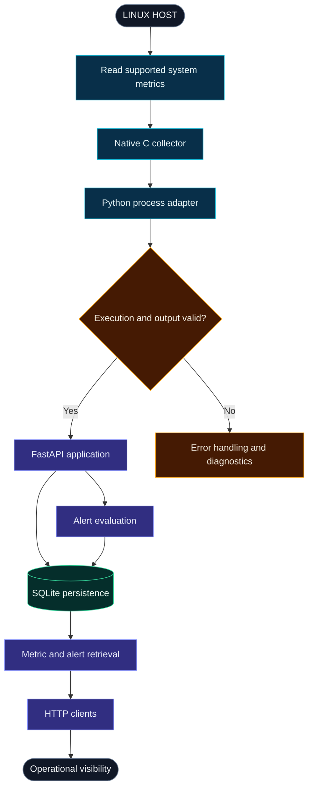
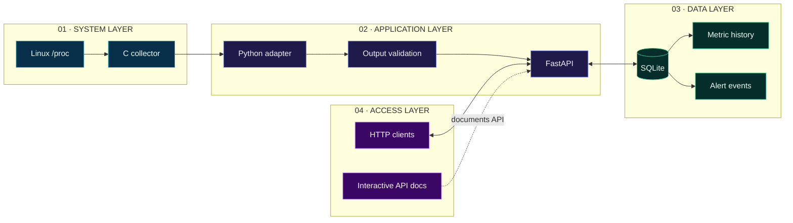
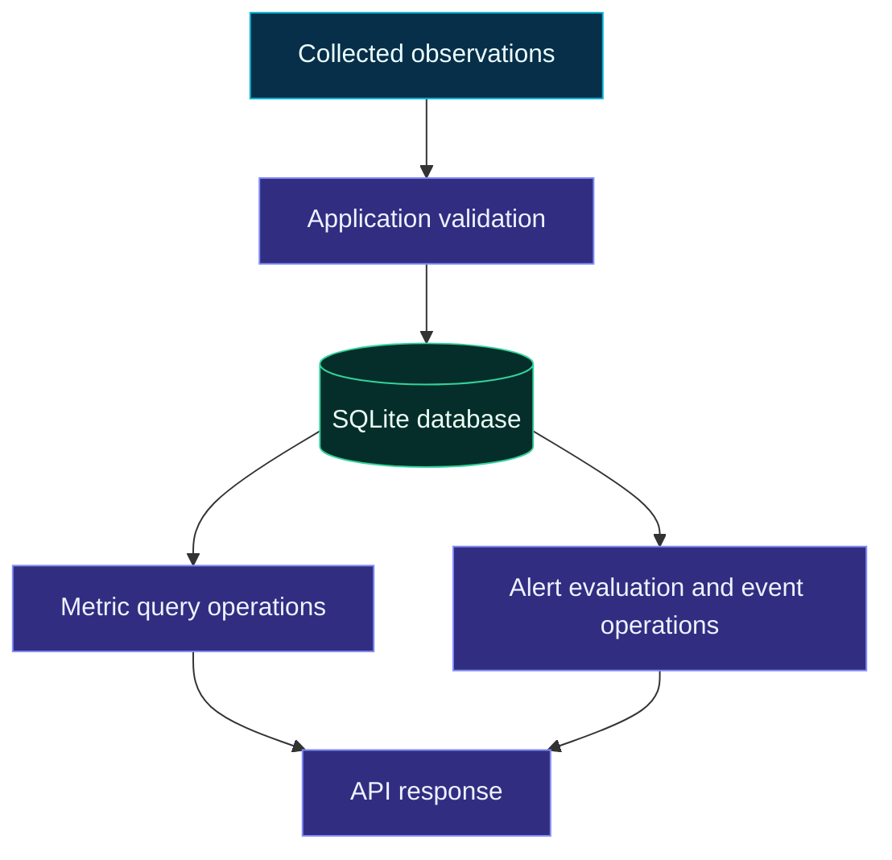
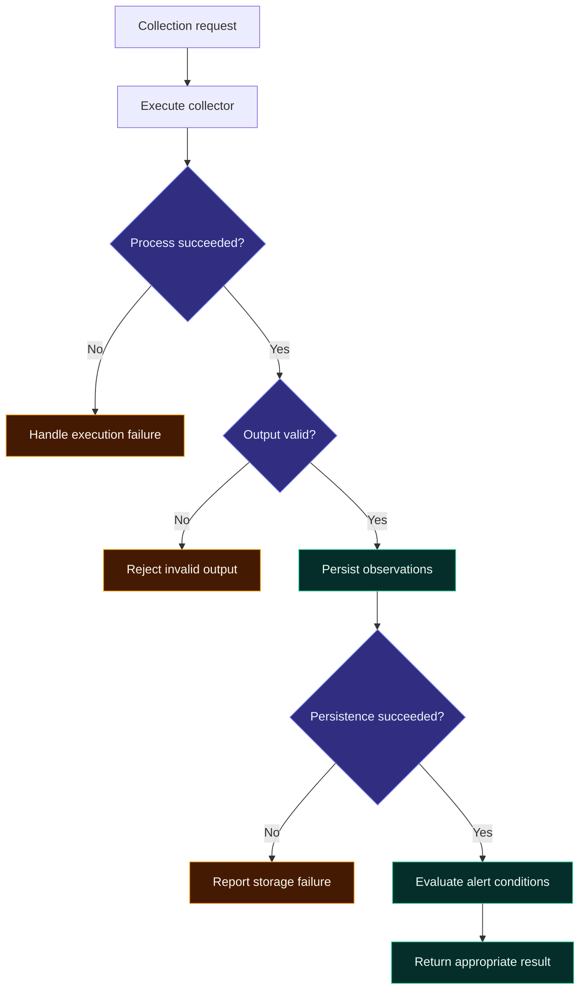

# ◈ SYSATLAS
### SYSTEMS OBSERVABILITY · RELIABILITY ENGINEERING · SYSTEMS SOFTWARE

<p align="center">
  
</p>

<p align="center">
  <strong>Observe the system. Understand the signals. Engineer for reliability.</strong>
</p>

<p align="center">
  <a href="https://github.com/akankshad1712/sysatlas">
    
  </a>
  
  
  
  
</p>

<p align="center">
  <a href="https://github.com/akankshad1712/sysatlas/tree/main/docs">ENGINEERING DOCUMENTATION</a>
  &nbsp; ◆ &nbsp;
  <a href="https://github.com/akankshad1712/sysatlas/tree/main/portfolio">PORTFOLIO MATERIAL</a>
  &nbsp; ◆ &nbsp;
  <a href="https://www.linkedin.com/in/akanksha-deshmukh-26210b244/">LINKEDIN</a>
</p>

---

## 01 / Executive overview

**SysAtlas is a Linux systems observability and reliability engineering project created by Akanksha Deshmukh.**

It explores how operating-system metrics can be collected through a native C component, passed across a Python application boundary, exposed through REST APIs, persisted in a local database, and evaluated against alert conditions.

The project brings together systems programming, backend development, process management, structured data, automated testing, containerization, and operational documentation in one codebase.

The central engineering question is:

> How can we transform low-level system signals into structured, accessible, and useful operational information?

### At a glance

| Dimension | Project details |
|---|---|
| Project | SysAtlas |
| Author | Akanksha Deshmukh |
| Category | Systems observability and reliability engineering |
| Systems component | C-based Linux collector |
| Application layer | Python and FastAPI |
| Persistence | SQLite |
| Interfaces | HTTP and JSON |
| Quality engineering | Pytest, shell tests, GitHub Actions configuration |
| Deployment configuration | Docker and Docker Compose |
| Documentation | Architecture, security, reliability, testing, and design records |
| Source code | [GitHub repository](https://github.com/akankshad1712/sysatlas) |

## 02 / The visual language

SysAtlas uses a focused, high-contrast visual identity inspired by modern developer platforms and technical product interfaces.

| Design token | Hex color | Intended use |
|---|---|---|
| Midnight | `#070B16` | Primary background |
| Deep Navy | `#111C3B` | Main surfaces |
| Electric Cyan | `#06B6D4` | Data flow and technical highlights |
| Indigo | `#6366F1` | Application and service boundaries |
| Violet | `#8B5CF6` | Architecture accents |
| Mint | `#34D399` | Successful validation and healthy states |
| Cloud White | `#F8FAFC` | Primary text |
| Slate | `#94A3B8` | Secondary information |

The palette establishes a consistent visual direction. GitHub controls the actual page styling, so the colors are expressed through banners, diagrams, badges, and visual assets rather than arbitrary README CSS.

## 03 / The engineering challenge

A monitoring pipeline is more than a metric collector. It needs a reliable way to move information between components, handle invalid output, expose useful interfaces, retain observations, and make failure conditions visible.

SysAtlas organizes these concerns into a sequence of explicit engineering boundaries.



*Architecture illustration: the precise runtime behavior should be verified against the implementation.*

### What each stage contributes

| Stage | Input | Responsibility | Output |
|---|---|---|---|
| Collection | Linux system interfaces | Read supported operating-system metrics | Collector output |
| Process boundary | Collector executable | Execute and manage the collection process | Process result |
| Validation | Collector output | Check data before downstream use | Accepted data or error |
| Application | Validated information | Coordinate API operations | Application responses |
| Persistence | Metrics and alert records | Store and retrieve information | Historical records |
| Alert evaluation | Observations and thresholds | Evaluate configured conditions | Alert-related records |
| API access | HTTP requests | Make supported operations accessible | HTTP responses |

## 04 / Architecture at a glance



### Component ownership

| Component | File | Responsibility |
|---|---|---|
| C collector | `collector/src/collector.c` | Linux-oriented system collection |
| Python adapter | `app/collector.py` | Collector process integration |
| Configuration | `app/config.py` | Application settings |
| API | `app/main.py` | HTTP endpoints and application orchestration |
| Database | `app/db.py` | Persistence and database operations |
| Alert logic | `app/alerts.py` | Alert evaluation |
| Application tests | `tests/test_app.py` | Python application tests |
| Collector tests | `collector/tests/test_collector.sh` | Collector test script |
| CI | `.github/workflows/ci.yml` | Automated workflow configuration |
| Container build | `Dockerfile` | Container image configuration |
| Container services | `docker-compose.yml` | Local service configuration |

## 05 / Feature matrix

| Capability | Engineering value | Implementation |
|---|---|---|
| Native systems collection | Explore low-level Linux interfaces | C collector |
| Process integration | Separate collection from application logic | Python adapter |
| Output validation | Define a boundary between components | Collector integration |
| REST API | Provide structured application access | FastAPI |
| Metric persistence | Retain observations | SQLite |
| Alert evaluation | Apply monitoring conditions | Alert module |
| Automated tests | Detect regressions | Pytest and shell tests |
| CI configuration | Automate selected checks | GitHub Actions |
| Containerization | Define a repeatable runtime environment | Docker |
| Engineering records | Explain technical decisions | `docs/engineering/` |
| Operational guidance | Document reliability and response considerations | `docs/` |

## 06 / API reference

The following routes are present in the project's documented interface. Check `app/main.py` for the authoritative HTTP methods, schemas, parameters, and response codes.

| Endpoint | Method | Intended operation |
|---|---|---|
| `/health` | GET | Application health check |
| `/ready` | GET | Application readiness check |
| `/api/v1/collect` | POST | Trigger metric collection |
| `/api/v1/metrics` | GET | Retrieve metric observations |
| `/api/v1/alerts` | GET | Retrieve alert information |

### Explore the API

When the application is running and FastAPI's documentation routes are enabled:

- Interactive Swagger UI: `http://127.0.0.1:8000/docs`
- ReDoc: `http://127.0.0.1:8000/redoc`

Example PowerShell requests:

```powershell
Invoke-RestMethod http://127.0.0.1:8000/health
Invoke-RestMethod http://127.0.0.1:8000/api/v1/metrics
Invoke-RestMethod http://127.0.0.1:8000/api/v1/alerts
```

These examples assume the service listens on port `8000`. They do not establish that the application has been started or that the endpoints have been tested in the current environment.

## 07 / Data and persistence model

SQLite is used as the local persistence technology.



| Data concern | Design objective |
|---|---|
| Metric records | Retain observations for retrieval |
| Alert records | Preserve alert-related information |
| Validation | Avoid passing malformed information into downstream processing |
| Database lifecycle | Initialize and access storage consistently |
| Growth | Consider retention, indexing, and query costs |
| Reliability | Handle persistence failures explicitly |

For the actual database schema, column definitions, transaction behavior, and initialization logic, refer to `app/db.py`.

## 08 / Repository structure

```text
sysatlas/
├── .github/
│   └── workflows/
│       └── ci.yml
├── app/
│   ├── __init__.py
│   ├── alerts.py
│   ├── collector.py
│   ├── config.py
│   ├── db.py
│   └── main.py
├── collector/
│   ├── src/
│   │   └── collector.c
│   └── tests/
│       └── test_collector.sh
├── docs/
│   ├── engineering/
│   ├── CAPACITY_PLANNING.md
│   ├── ENGINEERING_AUDIT.md
│   ├── ERROR_BUDGET.md
│   ├── INCIDENT_RESPONSE.md
│   ├── QUALITY_REPORT.md
│   ├── SECURITY_ARCHITECTURE.md
│   ├── SRE_PLAYBOOK.md
│   ├── TECHNICAL_DEBT.md
│   ├── TEST_MATRIX.md
│   └── THREAT_MODEL.md
├── portfolio/
│   ├── ARCHITECTURE_DEFENSE.md
│   ├── DEMO_SCRIPT.md
│   ├── GITHUB_ABOUT.md
│   ├── INTERVIEW_QA.md
│   ├── PROJECT_SUMMARY.md
│   ├── RESUME_BULLETS.md
│   └── TECHNICAL_WALKTHROUGH.md
├── tests/
│   └── test_app.py
├── .env.example
├── .gitignore
├── CHANGELOG.md
├── CONTRIBUTING.md
├── Dockerfile
├── docker-compose.yml
├── LICENSE
├── Makefile
├── README.md
├── requirements.txt
└── SECURITY.md
```

## 09 / Run locally

### Prerequisites

- Git
- A compatible Python installation
- Linux or WSL2 for the native Linux collector
- A C compiler for building and testing the collector
- Docker and Docker Compose for the containerized workflow

### Clone the repository

```bash
git clone https://github.com/akankshad1712/sysatlas.git
cd sysatlas
```

### Install Python dependencies

**Windows PowerShell**

```powershell
python -m venv .venv
.\.venv\Scripts\Activate.ps1
python -m pip install --upgrade pip
pip install -r requirements.txt
```

**Linux / WSL2**

```bash
python3 -m venv .venv
source .venv/bin/activate
python -m pip install --upgrade pip
pip install -r requirements.txt
```

### Run application tests

```bash
python -m pytest -q
```

### Run collector checks

From a compatible Linux environment:

```bash
sh collector/tests/test_collector.sh
```

### Run with Docker Compose

```bash
docker compose up --build
```

To stop the services:

```bash
docker compose down
```

**Important:** Confirm the build targets, startup commands, and service configuration in the repository before relying on these instructions. Running Python under Windows does not itself provide Linux `/proc` interfaces.

## 10 / Reliability and failure analysis

A useful observability system needs to handle failure, not only successful collection.



| Failure mode | Expected engineering concern |
|---|---|
| Collector timeout | Bound execution time |
| Non-zero process exit | Capture and surface diagnostics |
| Malformed output | Validate before processing |
| Database failure | Handle errors and preserve consistency |
| Alert threshold exceeded | Evaluate configured monitoring rules |
| API request invalid | Return appropriate HTTP behavior |
| CI check fails | Diagnose the failing stage before merging |

The diagram describes a recommended failure-analysis model. Verify that each branch is implemented and tested before presenting it as a guaranteed runtime behavior.

## 11 / Testing and CI/CD

| Quality layer | Repository location | Verification goal |
|---|---|---|
| Python tests | `tests/test_app.py` | Exercise application behavior |
| Collector tests | `collector/tests/test_collector.sh` | Check collector behavior |
| Dependency installation | `requirements.txt` | Reproduce Python environment setup |
| Container build | `Dockerfile` | Validate configured image construction |
| Service configuration | `docker-compose.yml` | Validate the container workflow |
| CI automation | `.github/workflows/ci.yml` | Execute the checks configured in CI |

The CI workflow should be treated as evidence only for the commands it actually executes. A successful workflow is not, by itself, a production-readiness certification.

## 12 / Security architecture

Security considerations for this project include:

- Keep real secrets out of source control.
- Use `.env.example` for placeholders, never live credentials.
- Avoid shell-based command construction where direct subprocess execution is appropriate.
- Bound process time and output.
- Validate data crossing component boundaries.
- Review API exposure before making the service publicly accessible.
- Check container privileges and filesystem access.
- Review dependency versions and database handling.

Related documentation:

| Document | Focus |
|---|---|
| `SECURITY.md` | Project security guidance |
| `docs/THREAT_MODEL.md` | Threat analysis |
| `docs/SECURITY_ARCHITECTURE.md` | Security design |
| `docs/engineering/SECURITY_REVIEW.md` | Security review material |
| `docs/engineering/RISK_REGISTER.md` | Risk tracking |

## 13 / Engineering decision records

The engineering documentation is intended to make design choices understandable and reviewable.

| Document | Engineering question |
|---|---|
| `docs/engineering/ADR-001-local-sqlite.md` | Why use local SQLite persistence? |
| `docs/engineering/ADR-002-c-collector.md` | Why use a native C collector? |
| `docs/engineering/SYSTEM_DESIGN.md` | How is the system organized? |
| `docs/engineering/ARCHITECTURE_EVOLUTION.md` | How might the architecture evolve? |
| `docs/engineering/SCALABILITY_ANALYSIS.md` | What limits scaling? |
| `docs/engineering/PERFORMANCE_REPORT.md` | What performance evidence exists? |
| `docs/engineering/TECHNICAL_DEBT.md` | What trade-offs or limitations remain? |
| `docs/engineering/OPERABILITY_REVIEW.md` | How should operational behavior be reviewed? |

Keep measured results, proposed improvements, and assumptions clearly distinguished in these documents.

## 14 / Development roadmap

- [ ] Verify the documented startup process from a clean environment.
- [ ] Publish passing application and collector test results.
- [ ] Add a genuine screenshot of the running dashboard, if available.
- [ ] Document concrete request and response examples.
- [ ] Measure collector latency and persistence behavior.
- [ ] Add reproducible performance tests.
- [ ] Validate container security and resource limits.
- [ ] Establish a clear retention strategy for stored metrics.
- [ ] Document known limitations and future architectural options.

These are improvement opportunities, not claims that the features are already complete.

## 15 / About the author

<p align="center">
  <strong>AKANKSHA DESHMUKH</strong>
  <br/>
  Software Engineer · Computer Engineering
  <br/><br/>
  <a href="https://www.linkedin.com/in/akanksha-deshmukh-26210b244/">
    
  </a>
  <a href="https://github.com/akankshad1712">
    
  </a>
</p>

SysAtlas is my engineering portfolio project for exploring systems programming, backend APIs, persistence, automated testing, and reliability-focused design.

My focus is on building understandable systems, documenting technical trade-offs, validating behavior, and continuously improving engineering quality.

## 16 / Explore the project

| Resource | Destination |
|---|---|
| Source code | [SysAtlas repository](https://github.com/akankshad1712/sysatlas) |
| Engineering documentation | [Documentation directory](https://github.com/akankshad1712/sysatlas/tree/main/docs) |
| Portfolio materials | [Portfolio directory](https://github.com/akankshad1712/sysatlas/tree/main/portfolio) |
| Professional profile | [Akanksha Deshmukh on LinkedIn](https://www.linkedin.com/in/akanksha-deshmukh-26210b244/) |

---

<p align="center">
  
  <strong>SYSATLAS · ENGINEERED WITH INTENT</strong>
  <br/>
  <sub>Observe deeply. Design deliberately. Build reliably.</sub>
</p>
