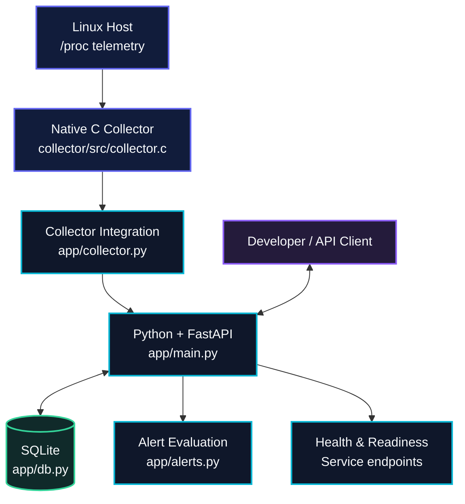
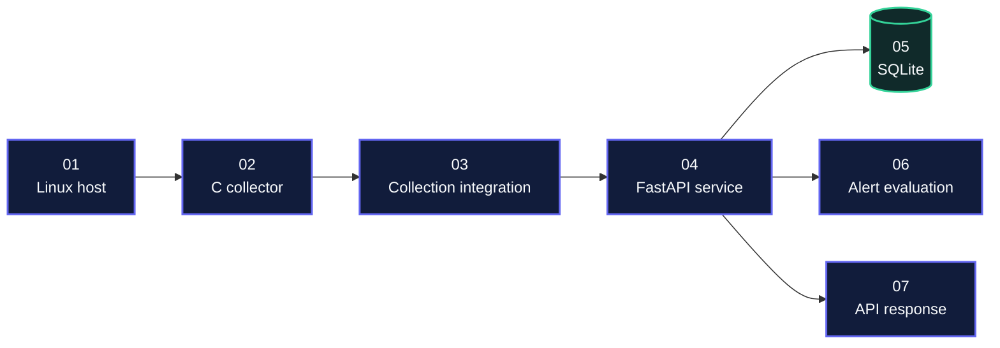
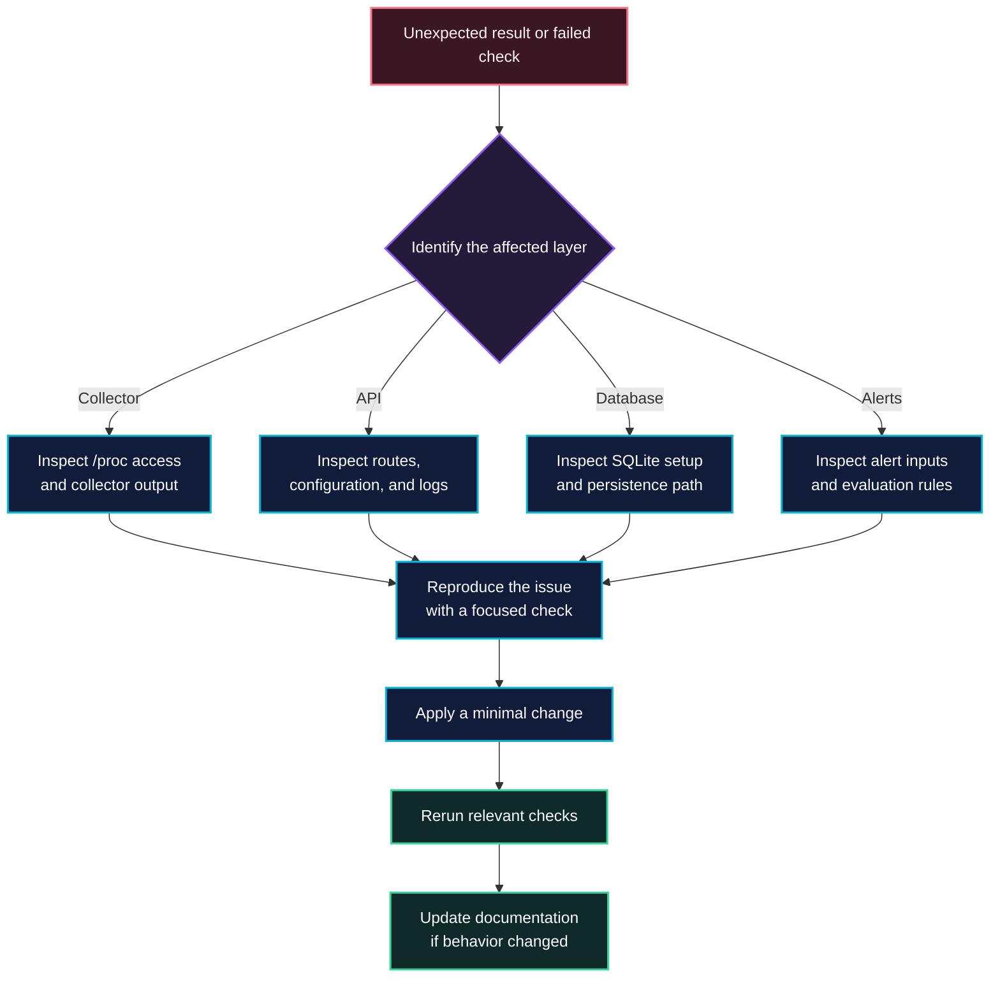

<div align="center">


<br>

**A systems observability project connecting native Linux telemetry, a Python API, persistent storage, and alert evaluation.**

<p>
  <a href="https://github.com/akankshad1712/sysatlas"></a>
  
  
  
  
</p>

[Overview](#-overview) · [Architecture](#-architecture) · [Data flow](#-data-flow) · [Quick start](#-quick-start) · [API](#-api-reference) · [Engineering](#-engineering-principles)

</div>

---

## ◈ Overview

**SysAtlas** is a systems-reliability and observability project designed to connect host-level telemetry with a service interface, persistent records, and alert evaluation.

The project combines a native C collector that reads Linux `/proc` data with a Python/FastAPI application, SQLite persistence, automated checks, and a Docker-based development workflow.

The engineering goal is straightforward: make the journey from system signals to application responses easier to understand, test, debug, and extend.

| Project detail | Description |
|---|---|
| **Project** | SysAtlas |
| **Category** | Systems engineering, observability, backend development |
| **Collector** | Native C |
| **Operating-system interface** | Linux `/proc` |
| **Application layer** | Python and FastAPI |
| **Persistence** | SQLite |
| **Testing** | Pytest and collector shell tests |
| **Container workflow** | Docker and Docker Compose |
| **CI configuration** | GitHub Actions workflow |
| **Author** | Akanksha Deshmukh |

> **Core principle:** separate collection, service logic, persistence, and alert evaluation so each part can be understood and verified independently.

## ✦ Project highlights

- **Native system collection:** uses C for the Linux telemetry collection component.
- **API-driven interaction:** organizes application functionality around a FastAPI service.
- **Persistent data:** uses SQLite through a dedicated database module.
- **Alert evaluation:** keeps alert-related logic in a separate application module.
- **Testing foundation:** includes application tests and collector-specific checks.
- **Containerized workflow:** includes a Dockerfile and Docker Compose configuration.
- **Engineering documentation:** provides a foundation for recording design decisions, risks, reliability concerns, and future improvements.

## ◈ Architecture

The following diagram shows the project's high-level component relationships.



### Component responsibilities

| Component | Responsibility | Location |
|---|---|---|
| Native collector | Reads host telemetry from Linux `/proc` | `collector/src/collector.c` |
| Collector integration | Connects collection functionality to the application | `app/collector.py` |
| API application | Coordinates service behavior and HTTP routes | `app/main.py` |
| Configuration | Centralizes application configuration | `app/config.py` |
| Database layer | Handles SQLite persistence | `app/db.py` |
| Alert module | Contains alert-evaluation logic | `app/alerts.py` |
| Application tests | Tests application behavior | `tests/test_app.py` |
| Collector tests | Checks collector-related behavior | `collector/tests/test_collector.sh` |
| CI workflow | Defines automated checks | `.github/workflows/ci.yml` |

## ◈ Data flow



### How the workflow fits together

1. **Collect:** the native collector reads available host signals from Linux `/proc`.
2. **Integrate:** the application connects collection functionality to its service workflow.
3. **Process:** FastAPI handles application requests and coordinates the relevant logic.
4. **Persist:** the database layer manages supported SQLite operations.
5. **Evaluate:** alert logic evaluates the relevant inputs and conditions.
6. **Respond:** API clients interact with the service through its registered HTTP endpoints.

The exact metrics, schemas, alert thresholds, and execution sequence should be confirmed against the current implementation before being treated as production guarantees.

## ◈ Capability matrix

| Area | Included project component | Engineering value |
|---|---|---|
| System telemetry | Native C collector | Low-level systems programming |
| Linux integration | `/proc` interface | Operating-system fundamentals |
| API development | FastAPI application | Backend service design |
| Data persistence | SQLite database layer | Storage and data management |
| Alerting | Alert evaluation module | Condition-based processing |
| Verification | Pytest and shell tests | Repeatable checks |
| Container workflow | Dockerfile and Compose | Environment consistency |
| Automation | GitHub Actions workflow | Continuous integration foundation |
| Documentation | Engineering and project docs | Maintainability and knowledge sharing |

## ◈ Repository structure

```text
sysatlas/
├── .github/
│   └── workflows/
│       └── ci.yml
├── app/
│   ├── __init__.py
│   ├── alerts.py
│   ├── collector.py
│   ├── config.py
│   ├── db.py
│   └── main.py
├── collector/
│   ├── src/
│   │   └── collector.c
│   └── tests/
│       └── test_collector.sh
├── docs/
│   └── engineering/
├── portfolio/
├── tests/
│   └── test_app.py
├── .env.example
├── .gitignore
├── CHANGELOG.md
├── CONTRIBUTING.md
├── Dockerfile
├── docker-compose.yml
├── LICENSE
├── Makefile
├── README.md
├── requirements.txt
└── SECURITY.md
```

## ◈ Quick start

### Prerequisites

- Git
- Python compatible with the versions and dependencies used by the project
- A C compiler and Linux-compatible environment for collector-related work
- Docker Desktop or Docker Engine if using Docker Compose

**Important:** the collector depends on Linux `/proc`. For Windows development, use WSL2 or a compatible Linux container for collector execution.

### 1. Clone the repository

```bash
git clone https://github.com/akankshad1712/sysatlas.git
cd sysatlas
```

### 2. Create a virtual environment

**Windows PowerShell**

```powershell
py -m venv .venv
.\.venv\Scripts\Activate.ps1
python -m pip install --upgrade pip
pip install -r requirements.txt
```

**Linux / macOS**

```bash
python3 -m venv .venv
source .venv/bin/activate
python -m pip install --upgrade pip
pip install -r requirements.txt
```

### 3. Configure the environment

Review `.env.example` and configure the variables required by the application.

Keep real credentials, tokens, and private configuration out of source control.

### 4. Run application tests

```bash
python -m pytest -q
```

### 5. Run collector checks

In a compatible shell environment:

```bash
sh collector/tests/test_collector.sh
```

### 6. Start the containerized environment

```bash
docker compose up --build
```

Review the container output to identify the actual service startup status and configured port.

To stop the environment:

```bash
docker compose down
```

**Verification note:** these commands are provided as the intended development workflow. Their success depends on the installed dependencies, environment configuration, platform, and current repository implementation. Run them locally to confirm.

## ◈ API reference

The following routes are the documented project endpoint names. Confirm their registered HTTP methods, schemas, and behavior in `app/main.py` before integrating with them.

| Endpoint | Intended purpose |
|---|---|
| `/health` | Basic service-health information |
| `/ready` | Readiness status |
| `/api/v1/collect` | Collection workflow |
| `/api/v1/metrics` | Metric access |
| `/api/v1/alerts` | Alert access |

### Interactive API documentation

After starting the service, check whether FastAPI's OpenAPI documentation is enabled at:

- `/docs`
- `/redoc`

These routes are available only if the application configuration exposes them. Use the actual local host and port reported by your running service.

## ◈ Engineering principles

SysAtlas is structured around a few practical software-engineering concerns.

| Principle | Application in the project |
|---|---|
| **Separation of concerns** | Collection, configuration, API handling, persistence, and alert logic live in distinct modules. |
| **Testability** | Application tests and collector checks provide places to verify behavior. |
| **Maintainability** | Focused modules and engineering documentation help developers navigate changes. |
| **Operational awareness** | Health-related endpoints and troubleshooting documentation support service inspection. |
| **Security hygiene** | Environment examples, ignore rules, and security documentation support safer development practices. |
| **Change management** | CI configuration, a changelog, and contribution guidance establish a foundation for disciplined updates. |

## ◈ Troubleshooting flow



## ◈ Security and responsible operation

- Store private values in environment variables or untracked local configuration.
- Keep `.env.example` limited to placeholders and safe defaults.
- Review `SECURITY.md` before reporting a vulnerability.
- Run collection code with only the permissions it needs.
- Review published ports and persistent volumes before exposing containers beyond local development.
- Protect collected host information according to the requirements of the environment where the project runs.

## ◈ Improvement roadmap

Potential improvements to consider as the implementation evolves:

- [ ] Document metric names, units, and collection intervals.
- [ ] Add concrete request and response examples for each endpoint.
- [ ] Expand tests for malformed inputs and failure scenarios.
- [ ] Document alert rules and threshold configuration.
- [ ] Standardize structured logging and error responses.
- [ ] Measure collector overhead and API response performance.
- [ ] Document reproducible Linux, WSL2, and Docker workflows.
- [ ] Record verified test results and supported runtime versions.

## ◈ Project resources

| Resource | Link |
|---|---|
| **Source repository** | [SysAtlas on GitHub](https://github.com/akankshad1712/sysatlas) |
| **Engineering documentation** | [Browse `docs/`](https://github.com/akankshad1712/sysatlas/tree/main/docs) |
| **Portfolio materials** | [Browse `portfolio/`](https://github.com/akankshad1712/sysatlas/tree/main/portfolio) |
| **Issues and improvements** | [GitHub Issues](https://github.com/akankshad1712/sysatlas/issues) |
| **Author profile** | [Akanksha Deshmukh on LinkedIn](https://www.linkedin.com/in/akanksha-deshmukh-26210b244/) |
| **Other projects** | [GitHub profile](https://github.com/akankshad1712) |

## ◈ Author

<div align="center">

### Akanksha Deshmukh

**Software Engineer · Systems & Backend Engineering**

Interested in building practical software with clear architecture, reliable behavior, testable components, and maintainable engineering workflows.

[](https://www.linkedin.com/in/akanksha-deshmukh-26210b244/)
[](https://github.com/akankshad1712)

</div>

---

<div align="center">

**SysAtlas** · A personal engineering project by **Akanksha Deshmukh**

*From Linux telemetry to understandable, testable service behavior.*

</div>
