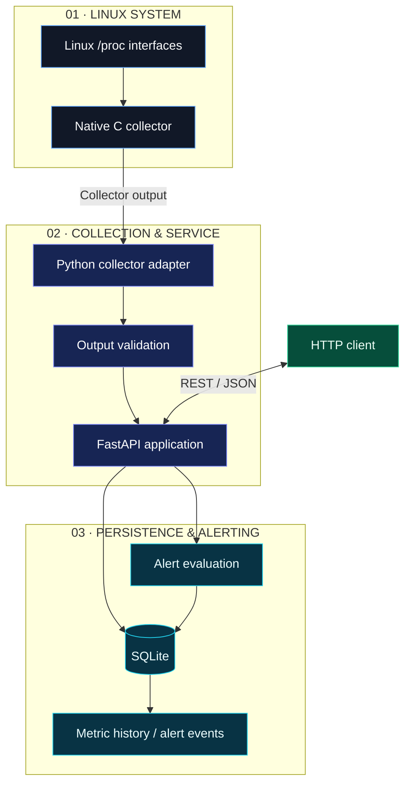

# ◈ SYSATLAS

<p align="center">
  
</p>

<p align="center">
  <strong>See the signals. Understand the system. Engineer for reliability.</strong>
</p>

<p align="center">
  <a href="https://github.com/akankshad1712/sysatlas"></a>
  
  
  
</p>

<p align="center">
  <a href="https://github.com/akankshad1712/sysatlas">Repository</a>
  &nbsp; ◆ &nbsp;
  <a href="https://github.com/akankshad1712/sysatlas/tree/main/docs">Engineering Docs</a>
  &nbsp; ◆ &nbsp;
  <a href="https://github.com/akankshad1712/sysatlas/tree/main/portfolio">Portfolio & Interview Guide</a>
  &nbsp; ◆ &nbsp;
  <a href="https://www.linkedin.com/in/akanksha-deshmukh-26210b244/">Connect on LinkedIn</a>
</p>

---

## ◈ 01 / The vision

**SysAtlas is a Linux systems observability and reliability engineering project** that explores the journey from operating-system signals to structured metrics, API-driven access, persistent history, and threshold-based alerts.

Built around a native C collector and a Python/FastAPI application, the project brings together systems programming, backend engineering, data persistence, testing, containerization, and operational documentation.

The goal is not simply to collect metrics. It is to make the boundaries, failure modes, and engineering decisions of a monitoring pipeline understandable and testable.

<table>
  <tr>
    <td width="50%">
      <h3>01 — COLLECT</h3>
      Read supported system metrics through Linux interfaces.
    </td>
    <td width="50%">
      <h3>02 — VALIDATE</h3>
      Process collector output through an application boundary.
    </td>
  </tr>
  <tr>
    <td width="50%">
      <h3>03 — OBSERVE</h3>
      Expose application operations through REST endpoints.
    </td>
    <td width="50%">
      <h3>04 — RESPOND</h3>
      Persist observations and evaluate alert conditions.
    </td>
  </tr>
</table>

## ◈ 02 / Technology constellation

<p align="center">
  
</p>

| Layer | Technology | Purpose |
|---|---|---|
| Systems layer | C | Native Linux metric collection |
| Service layer | Python | Collector integration and application logic |
| API layer | FastAPI | HTTP endpoints and service access |
| Data layer | SQLite | Local metric and alert-event persistence |
| Quality layer | Pytest, shell tests | Automated verification |
| Delivery layer | Docker, Docker Compose | Containerized development and execution |
| Automation layer | GitHub Actions | Continuous integration checks |
| Documentation | Markdown, Mermaid | Architecture and engineering decisions |

## ◈ 03 / Architecture blueprint

The architecture below illustrates the principal component boundaries. Consult the implementation to verify the precise runtime data flow.



### Architectural responsibilities

| Component | Responsibility | Design consideration |
|---|---|---|
| C collector | Read supported Linux system information | Native execution and explicit output format |
| Python adapter | Execute and manage the collector | Process errors, timeouts, and output limits |
| Validation | Check collected data | Reject malformed or unexpected output |
| FastAPI | Serve application endpoints | Consistent HTTP behavior |
| SQLite | Persist observations and alert records | Transactions and database lifecycle |
| Alert logic | Evaluate monitoring conditions | Explicit thresholds and event semantics |
| CI workflow | Run configured checks | Reproducible quality gates |

## ◈ 04 / Feature portfolio

| Capability | Description | Code location |
|---|---|---|
| Native collection | Linux-oriented system metrics | `collector/src/collector.c` |
| Process integration | Python-to-C execution boundary | `app/collector.py` |
| Configuration | Application settings | `app/config.py` |
| REST service | API endpoints | `app/main.py` |
| Persistence | Database operations | `app/db.py` |
| Alert evaluation | Monitoring rules | `app/alerts.py` |
| Application tests | Python test suite | `tests/test_app.py` |
| Collector tests | Native collector checks | `collector/tests/test_collector.sh` |
| CI automation | Configured GitHub workflow | `.github/workflows/ci.yml` |
| Container setup | Image and Compose configuration | `Dockerfile`, `docker-compose.yml` |

## ◈ 05 / API surface

The project documents the following endpoint paths. Check `app/main.py` for the authoritative methods, parameters, schemas, and response codes.

| Endpoint | Method | Purpose |
|---|---|---|
| `/health` | GET | Health check |
| `/ready` | GET | Readiness check |
| `/api/v1/collect` | POST | Collection operation |
| `/api/v1/metrics` | GET | Metric retrieval |
| `/api/v1/alerts` | GET | Alert retrieval |

When the application is running with FastAPI's documentation enabled, explore:

- Interactive API documentation: `http://127.0.0.1:8000/docs`
- Alternative API reference: `http://127.0.0.1:8000/redoc`

## ◈ 06 / Repository map

```text
sysatlas/
├── .github/workflows/ci.yml
├── app/
│   ├── alerts.py
│   ├── collector.py
│   ├── config.py
│   ├── db.py
│   └── main.py
├── collector/
│   ├── src/collector.c
│   └── tests/test_collector.sh
├── docs/
│   ├── engineering/
│   ├── CAPACITY_PLANNING.md
│   ├── ENGINEERING_AUDIT.md
│   ├── ERROR_BUDGET.md
│   ├── INCIDENT_RESPONSE.md
│   ├── QUALITY_REPORT.md
│   ├── SECURITY_ARCHITECTURE.md
│   ├── SRE_PLAYBOOK.md
│   ├── TECHNICAL_DEBT.md
│   ├── TEST_MATRIX.md
│   └── THREAT_MODEL.md
├── portfolio/
│   ├── ARCHITECTURE_DEFENSE.md
│   ├── DEMO_SCRIPT.md
│   ├── GITHUB_ABOUT.md
│   ├── INTERVIEW_QA.md
│   ├── PROJECT_SUMMARY.md
│   ├── RESUME_BULLETS.md
│   └── TECHNICAL_WALKTHROUGH.md
├── tests/test_app.py
├── .env.example
├── .gitignore
├── Dockerfile
├── docker-compose.yml
├── Makefile
├── requirements.txt
└── README.md
```

## ◈ 07 / Quick start

### Prerequisites

- Git
- Python compatible with `requirements.txt`
- Linux or WSL2 for the native Linux collector
- A C compiler for building the collector
- Docker, if using the containerized configuration

### Clone

```bash
git clone https://github.com/akankshad1712/sysatlas.git
cd sysatlas
```

### Install Python dependencies

**Windows PowerShell**

```powershell
python -m venv .venv
.\.venv\Scripts\Activate.ps1
python -m pip install --upgrade pip
pip install -r requirements.txt
```

**Linux / WSL2**

```bash
python3 -m venv .venv
source .venv/bin/activate
python -m pip install --upgrade pip
pip install -r requirements.txt
```

### Run tests

```bash
python -m pytest -q
```

### Start the container configuration

```bash
docker compose up --build
```

Stop the services:

```bash
docker compose down
```

> **Platform note:** Installing the Python dependencies on Windows does not provide Linux `/proc` interfaces. Run the native collector in a compatible Linux environment. Confirm the Docker configuration and startup instructions before relying on the commands above.

## ◈ 08 / Reliability engineering

SysAtlas includes dedicated engineering documentation for discussing reliability, security, operational readiness, and technical trade-offs.

| Engineering topic | Documentation |
|---|---|
| Threat modeling | `docs/THREAT_MODEL.md` |
| Security architecture | `docs/SECURITY_ARCHITECTURE.md` |
| Incident response | `docs/INCIDENT_RESPONSE.md` |
| SRE practices | `docs/SRE_PLAYBOOK.md` |
| Error budgets | `docs/ERROR_BUDGET.md` |
| Capacity planning | `docs/CAPACITY_PLANNING.md` |
| Test coverage strategy | `docs/TEST_MATRIX.md` |
| Technical debt | `docs/TECHNICAL_DEBT.md` |
| Architecture decisions | `docs/engineering/` |

### Failure modes worth understanding

- Collector process failure or timeout
- Malformed collector output
- Database write or initialization errors
- Threshold-triggered alerts
- API validation and HTTP errors
- Container build or runtime failures
- Regressions caught by automated tests

These are engineering concerns to validate through code review and testing; the presence of documentation does not by itself establish production readiness.

## ◈ 09 / Engineering decision records

The project includes design records for key technical choices.

<details>
<summary><strong>ADR-001 — Local SQLite persistence</strong></summary>

Review `docs/engineering/ADR-001-local-sqlite.md`.

Consider database initialization, transaction behavior, concurrency, retention, and the point at which a different storage architecture would be appropriate.

</details>

<details>
<summary><strong>ADR-002 — Native C collector</strong></summary>

Review `docs/engineering/ADR-002-c-collector.md`.

Consider the trade-offs between native system access, process isolation, portability, output contracts, and integration complexity.

</details>

<details>
<summary><strong>Scalability and evolution</strong></summary>

Explore:

- `docs/engineering/SCALABILITY_ANALYSIS.md`
- `docs/engineering/ARCHITECTURE_EVOLUTION.md`
- `docs/engineering/PERFORMANCE_REPORT.md`
- `docs/engineering/RISK_REGISTER.md`

Use measured benchmarks and reproducible experiments to support performance or scalability claims.

</details>

## ◈ 10 / Development quality gates

| Gate | Validation |
|---|---|
| Application tests | `python -m pytest -q` |
| Collector checks | Run the shell test in Linux |
| Container build | `docker compose up --build` |
| CI | Inspect the GitHub Actions workflow result |
| Security | Review secret handling and exposed interfaces |
| Documentation | Keep architecture and implementation aligned |

Potential next steps:

- [ ] Publish a verified passing test result.
- [ ] Add a real dashboard screenshot.
- [ ] Document metric schemas and example responses.
- [ ] Measure collection latency and database behavior.
- [ ] Add reproducible load tests.
- [ ] Review container permissions and resource limits.
- [ ] Document known limitations and future work.

## ◈ 11 / About the engineer

<p align="center">
  <strong>AKANKSHA DESHMUKH</strong><br/>
  Software Engineer · Computer Engineering
  <br/><br/>
  <a href="https://www.linkedin.com/in/akanksha-deshmukh-26210b244/">
    
  </a>
  <a href="https://github.com/akankshad1712">
    
  </a>
</p>

I use SysAtlas to explore systems programming, backend services, API design, testing, and reliability-focused engineering. The project emphasizes understandable architecture, maintainable code, and technical decisions that can be explained and verified.

## ◈ 12 / Project links

| Resource | Link |
|---|---|
| Source repository | [akankshad1712/sysatlas](https://github.com/akankshad1712/sysatlas) |
| Engineering documentation | [Browse docs](https://github.com/akankshad1712/sysatlas/tree/main/docs) |
| Portfolio material | [Browse portfolio](https://github.com/akankshad1712/sysatlas/tree/main/portfolio) |
| Professional profile | [LinkedIn](https://www.linkedin.com/in/akanksha-deshmukh-26210b244/) |

---

<p align="center">
  
  <br/>
  <strong>SYSATLAS</strong><br/>
  <sub>Observe deeply. Design deliberately. Build reliably.</sub>
</p>
