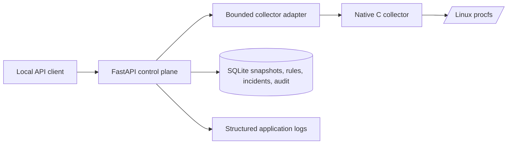

# System Design

## Components

The C collector is the data plane and owns parsing of kernel-provided files. Python is the control plane and owns HTTP contracts, orchestration, persistence, and rule evaluation. SQLite is intentionally chosen for local reproducibility; introducing a distributed queue or database is deferred until measurements justify it.

## Request path

1. Client calls a versioned API route.
2. Pydantic validates user-supplied rule input.
3. Collection route runs the fixed collector binary with a timeout.
4. Adapter parses JSON and checks the protocol envelope.
5. Persistence stores a snapshot transactionally and records an audit event.
6. Alert evaluation calculates memory pressure and updates incident state.

## Failure behavior

Collector startup/timeout/exit/protocol errors become a 503 response. Readiness reports a database failure. Internal API errors return a generic message; details remain in server logs. The current implementation is single-instance and local-first.
